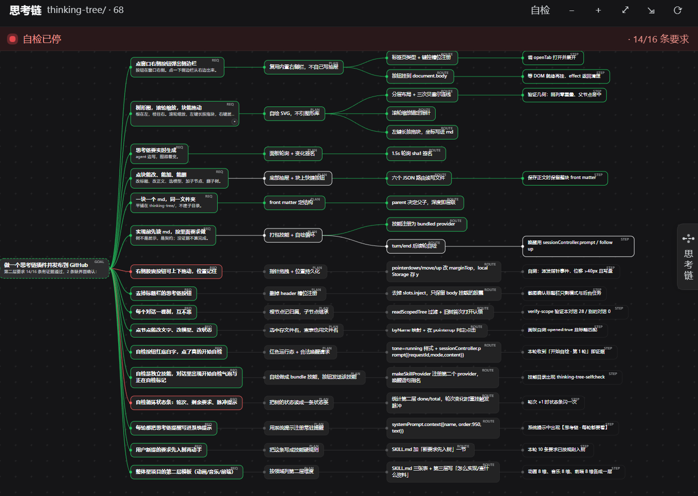

<div align="center">


# dsh-thinking-tree

**A tree-shaped chain of thought in the DeepSeek Harness right sidebar — stored as plain Markdown you can edit.**

[](LICENSE)
[](package.json)
[](test)
[](https://github.com/deepseek-ai)
[](#the-three-skills)

[中文说明](README.zh.md) · [Plugin details](docs/DETAIL.md)

</div>



---

## What it is

A DSH plugin that turns a long task into a **visible tree of thought** the agent maintains while it works, and that you can edit at any time.

- **Goal at the top, work at the bottom.** `GOAL → REQ → PLAN → ROUTE → STEP`, drawn as a mind map with curved links.
- **Every block is a Markdown file.** Click it in the panel to rewrite it; the agent re-reads the folder before it implements, so your edit wins.
- **Live.** The panel polls the folder about every 1.5 s; whatever the agent writes shows up while it is still working.

## Why a folder of files

- **The user can edit the plan.** Click a card, change the text, save. Status cycles pending → in progress → done → blocked. Add a child, delete a subtree.
- **The agent reads the same thing.** The bundled `thinking-tree` skill tells it to build the tree at the start of a multi-step task, keep it updated while it works, and **re-read the folder before implementing instead of trusting its memory of the plan**.
- **A requirement is decomposed before any work starts — without relying on the model remembering.** The five-question mandate (what it is / what "done" looks like / which independent pieces / how each is built / how each is verified) is registered as a system-prompt context, so it is in the model's context **every step**; the `requirement-breakdown` skill is only the detailed manual behind that rule.
- **The panel is live.** It re-reads the folder about every 1.5 s while open, so the tree grows as the agent writes. Editing pauses the refresh.

## Features

| | |
|---|---|
| 🗺 **Mind map, not a list** | Left-to-right layout, bezier links, status dots, per-tier colours. Wheel zooms (pointer-anchored), left-drag moves a block, drag the canvas to pan. |
| ✏️ **Edit anything** | Title, body, status, model, add child, delete subtree — all from the panel drawer. Saves keep the front matter intact. |
| 📄 **Plain Markdown** | One file per block under `<workspace>/thinking-tree/s-<id>/`. Sortable, greppable, diffable, yours. |
| 🔒 **Per-conversation trees** | Each conversation has its own subfolder; another conversation's nodes cannot leak in. Older flat trees migrate on first read. |
| 🧪 **Self-check loop** | A red button in the header starts a verifying round; every finished turn starts the next one (40 rounds max) until the goal is proven or stopped. |
| 🧠 **Per-node model** | Give any block `provider/model` and the agent delegates that block to that model. |
| 🗂 **Collapsed detail** | Cards show a title and one line; click ▾ to expand the whole body (up to 16 lines) inside the card. |
| 🌐 **Bilingual UI** | English and Chinese strings follow the DSH locale. |

## Install

Requires a DSH build with the right sidebar (`@deepseek-ai/dsh-client-ui-sidebar-right`).

1. **Plugins → Add plugin**, point at this directory (or a clone of this repo).
2. Enable the `thinking-tree` bundle if it did not enable itself.
3. Open a conversation and click the pill on the right edge of the window.

> The pill can be dragged up and down; its position is remembered.

## The three skills

| Skill | When it fires |
|---|---|
| `thinking-tree` | Always available. Defines the on-disk contract, the five tiers, how to write a block, how to keep a long task on the rails. |
| `requirement-breakdown` | The manual behind the always-on decomposition mandate (five questions, granularity rules, node template, pre-work checklist). |
| `thinking-tree-selfcheck` | Sent by the self-check button. One verification round: prove each requirement with evidence, fix what is missing, only then declare it passed. |

The first two are reinforced by **system-prompt contexts**, so the rules apply on every step even when the model never loads a skill.

## File format

```
<workspace>/thinking-tree/
└── s-4a0fbba9/                → this conversation (id prefix of the session)
    ├── 00-goal.md             → goal
    ├── 01-tech-route.md       → approach
    ├── 01-1-host-route.md     → step
    └── 02-visual-style.md     → approach
```

`parent` in the front matter decides the shape; file names are for humans. Depth *is* the tier.

```markdown
---
id: 01-req-panel
parent: 00-goal
order: 0
title: 点右侧按钮弹出侧边栏
status: pending
model: ""
x: ""
y: ""
session: session-4a0fbba9-eba
---

点击窗口右边缘的按钮，从右边滑出侧边栏。

## 做成什么样
面板出现在右侧栏，宽度可拖，显示整棵树。

## 怎么验证
点按钮 → 面板出现；拖动分隔条 → 宽度变化并记住。
```

## Usage

- **Open the panel**: click the pill on the right edge (or the `思考链` tab in the right sidebar).
- **Edit a block**: click it → the drawer opens with title, status, model and body.
- **Move a block**: hold the left button and drag; the position is written to `x`/`y`.
- **Expand detail**: click ▾ at the bottom-right of a card.
- **Self-check**: click the red button. It turns into `自检中 · 第 N 轮` and the panel shows a status strip with `done/total` requirements.
- **Per-node model**: set it in the drawer; the agent will delegate that block with `subagent`.

## Architecture

| File | Role |
|---|---|
| `index.js` | Host half: registers three skill providers, the system-prompt mandates, the self-check loop and the `/api/thinking-tree` JSON routes (`tree`, `save`, `create`, `status`, `title`, `model`, `models`, `position`, `arrange`, `delete`, `selfcheck`, `sessions`, `diag`). |
| `client.js` | Browser half: the right-sidebar tab, the mind-map layout and rendering, the drawer, the draggable pill, the self-check strip. |
| `assets/*/SKILL.md` | Skill bodies. |
| `test/*.mjs` | `node test/api.test.mjs` (20 checks over the write path) and `node test/layout.test.mjs` (10 checks over the geometry). |

```bash
node test/api.test.mjs      # 20/20
node test/layout.test.mjs   # 10/10
```

The layout test loads the geometry code straight out of `client.js`, so it asserts the shipped algorithm rather than a copy.

## Known limits

- The panel needs the right sidebar plugin; without it the tab cannot dock.
- The self-check loop stops after 40 rounds and leaves `selfcheck: stopped` on the goal.
- Block text is clipped to 16 lines when expanded; the full text lives in the file.

## License

GNU General Public License v3.0 or later — see [LICENSE](LICENSE).