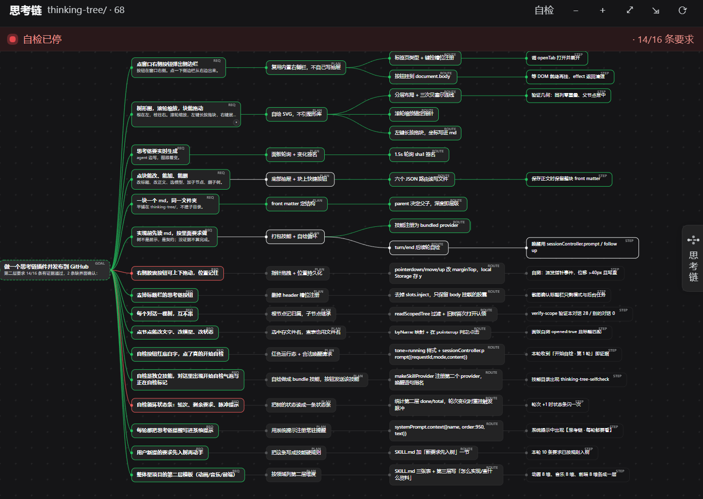
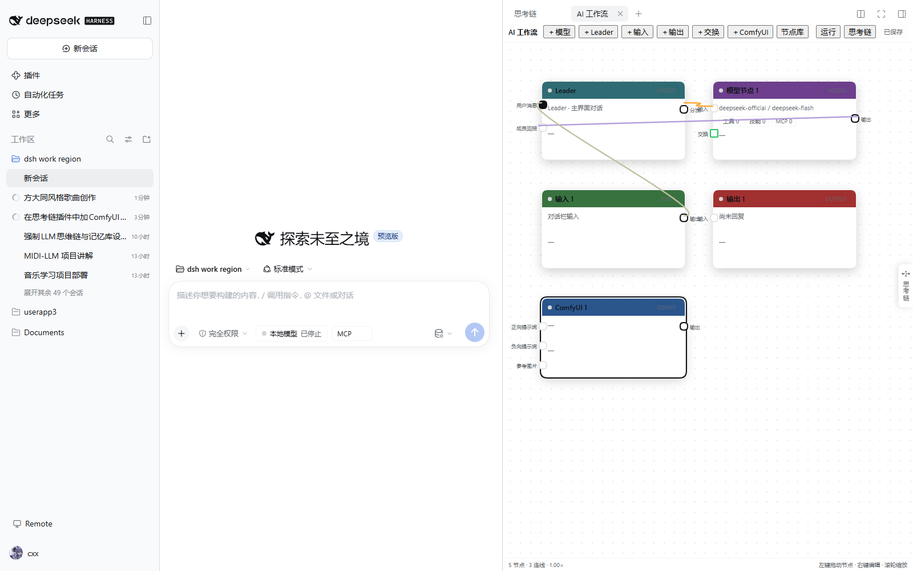
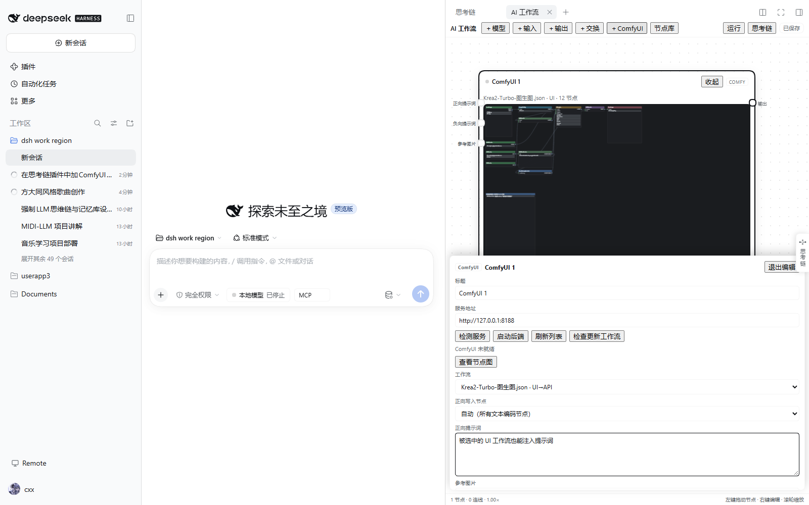

<div align="center">


# dsh-thinking-tree

**在 DeepSeek Harness 右侧栏里画出一棵实时的思维链树——底层就是你随时能改的 Markdown。**

[](LICENSE)
[](package.json)
[](test)
[](https://github.com/deepseek-ai)
[](#三个技能)

[English](README.md) · [插件详情](docs/DETAIL.zh.md)

</div>



---

## 它是什么

一个 DSH 插件：把一件多步骤的活变成**看得见的思考链**。agent 边做边维护它，你随时能改。

- **上面是目标，下面是活。** `GOAL → REQ → PLAN → ROUTE → STEP`，用曲线连成思维导图。
- **每个块就是一个 Markdown 文件。** 点开就能改；agent 动手前会重读文件夹，所以你的修改优先。
- **实时的。** 面板每 1.5 秒左右重读一次文件夹，agent 边写你边看见。

## 为什么要落在文件上

- **用户能改计划。** 点块改正文、改状态（待办 → 进行中 → 完成 → 受阻）、加子节点、删一棵子树，都是直接改文件。
- **agent 读的是同一份东西。** 附带技能 `thinking-tree` 规定：多步骤任务开始时建树、做的过程中持续更新，最关键的一条是**动手实现前重读文件夹，按你改的做，而不是按它记忆里的旧方案做**。
- **收到要求先拆解，且不靠"想起来"。** 五问（要什么 / 做成什么样 / 拆成几块 / 每块怎么做 / 每块怎么验证）注册进了系统提示，**每一轮都在上下文里**，不需要模型主动加载技能；`requirement-breakdown` 技能只是这套规则的详细手册。
- **面板是实时的。** 打开时每 1.5 秒左右重读一次，正在编辑或正在缩放时暂停刷新。

## 功能

| | |
|---|---|
| 🗺 **是树不是列表** | 从左到右分层布局、贝塞尔连线、状态点、每层不同配色。滚轮缩放（锚定指针）、左键长按拖块、拖画布平移。 |
| ✏️ **什么都能改** | 标题、正文、状态、模型、加子节点、删子树——全在面板抽屉里。保存不会冲掉 front matter。 |
| 📄 **纯 Markdown** | 一个块一个文件，放在 `<工作区>/thinking-tree/s-<id>/`。能排序、能 grep、能 diff、归你所有。 |
| 🔒 **每个对话一棵树** | 每个对话一个子目录，别的对话的节点串不进来；旧的平铺树首次读取时自动迁移。 |
| 🧪 **自检循环** | 点标题栏的红色按钮开始一轮核对，之后每轮结束自动继续（最多 40 轮），直到目标被证据证明或你手动停。 |
| 🧠 **节点级模型** | 给某个块写 `provider/model`，agent 就把这个块派给那个模型做。 |
| 🗂 **正文折叠** | 卡片默认只显示标题 + 一行摘要；点 ▾ 在卡片内展开整段正文（最多 16 行）。 |
| 🌐 **中英双语** | 界面文案跟随 DSH 的语言设置。 |

## 安装

前提：你的 DSH 带右侧边栏（`@deepseek-ai/dsh-client-ui-sidebar-right`）。

1. **插件 → 添加插件**，选这个目录（或克隆下来的仓库）。
2. 如果 `thinking-tree` 这个 bundle 没有自动启用，手动启用。
3. 打开一个会话，点窗口右边缘的胶囊按钮。

> 胶囊按钮可以上下拖动，松手后位置会被记住。

## 三个技能

| 技能 | 什么时候生效 |
|---|---|
| `thinking-tree` | 常驻可用。定义磁盘契约、五层结构、正文怎么写、长任务怎么不跑偏。 |
| `requirement-breakdown` | 常驻拆解规则的详细手册（五问、粒度、节点模板、动手前自检清单）。 |
| `thinking-tree-selfcheck` | 自检按钮触发。一轮核对：逐条拿证据，缺什么补什么，最后才宣布通过。 |

前两条同时写进了**系统提示上下文**，所以每一步都在，不依赖模型主动加载技能。

## 文件格式

```
<工作区>/thinking-tree/
└── s-4a0fbba9/                → 这个对话（会话 id 前 8 位）
    ├── 00-goal.md             → 目标
    ├── 01-tech-route.md       → 方案
    ├── 01-1-host-route.md     → 步骤
    └── 02-visual-style.md     → 方案
```

树形由 front matter 里的 `parent` 决定，文件名只是给人看的。**深度就是层级。**

```markdown
---
id: 01-req-panel
parent: 00-goal
order: 0
title: 点右侧按钮弹出侧边栏
status: pending
model: ""
x: ""
y: ""
session: session-4a0fbba9-eba
---

点击窗口右边缘的按钮，从右边滑出侧边栏。

## 做成什么样
面板出现在右侧栏，宽度可拖，显示整棵树。

## 怎么验证
点按钮 → 面板出现；拖动分隔条 → 宽度变化并记住。
```

## 用法

- **打开面板**：点右边缘胶囊，或右侧栏的「思考链」标签页。
- **改一个块**：点它 → 抽屉打开，能改标题、状态、模型和正文。
- **挪一个块**：左键长按拖动，位置写进 `x`/`y`。
- **展开正文**：点卡片右下 ▾。
- **自检**：点红色按钮 → 变成「自检中 · 第 N 轮」，面板顶部出现带 `已完成/总数` 的状态条。
- **节点级模型**：在抽屉里选，agent 会用 `subagent` 把这个块派给那个模型。

## AI 工作流（ComfyUI 式画布）

右侧栏还有第二个标签页「AI 工作流」：一张可拖拽缩放的画布，把多个 AI 节点和一个 ComfyUI 后端接成一张图。



### 五类节点

| 节点 | 作用 | 端口 |
|---|---|---|
| **Leader** | 就是主界面这场对话：派单、收结果、把汇总作为回复 | 用户消息 / 成员回报（入）、分发（出） |
| **输入** | 取主界面对话栏的文字，送进下游 | 出 |
| **输出** | 收到什么就作为主界面回复发出去（文本与图片） | 入 |
| **模型** | 一个智能体成员：选 provider/model、工具、skill、MCP，写自己的提示词 | 入 / 交换 / 出 |
| **交换** | 按自己的提示词收集上游、改写、按目标分发 | 入 / 出（分发） |
| **ComfyUI** | 跑本机 ComfyUI 工作流，图片可回灌给视觉模型 | 正向 / 负向 / 参考图（入）、出 |

### 三个关键约定

- **上下文隔离**：每个模型节点运行时有自己的 system、messages、工具集；别的节点只能通过连线或交换节点拿到它输出的那段文字。
- **每轮重新加载**：节点提示词与所选 skill 每次运行都从磁盘重读，改完下一次运行即生效，不缓存。
- **ComfyUI 逆向**：扫描本机三个工作流目录（UI 格式与 API 格式都可），UI 文件按 `/object_info` 的 widget 顺序自动转成可执行图；用 litegraph 语义把真实节点图画在卡片里，点击节点即可指定提示词注入到哪个节点。



```bash
node --test test/workflow.test.mjs   # 23/23：图结构、隔离、交换、输入输出、Leader、skill 每轮重载
```
## 结构

| 文件 | 作用 |
|---|---|
| `index.js` | Host 半边：注册三个技能 provider、系统提示强制规则、自检循环，以及 `/api/thinking-tree` 下的 JSON 路由（`tree`/`save`/`create`/`status`/`title`/`model`/`models`/`position`/`arrange`/`delete`/`selfcheck`/`sessions`/`diag`）。 |
| `client.js` | 浏览器半边：右侧栏标签页、思维导图布局与渲染、抽屉、可拖胶囊、自检状态条，以及 AI 工作流画布与内联 litegraph 渲染器。 |
| `assets/*/SKILL.md` | 技能正文。 |
| `workflow.js` | AI 工作流 Host：图存储、节点执行（隔离上下文）、交换节点、ComfyUI 扫描/转换/运行/注入目标。 |
| `test/*.mjs` | `api.test.mjs`（20）、`layout.test.mjs`（10）、`workflow.test.mjs`（23）。 |

```bash
node test/api.test.mjs      # 20/20
node test/layout.test.mjs   # 10/10
```

布局测试直接从 `client.js` 里加载几何代码，所以断言的是发行代码本身，不是副本。

## 已知限制

- 面板依赖右侧栏插件，没有它标签页无法停靠。
- 自检循环最多 40 轮，之后会在目标节点留下 `selfcheck: stopped`。
- 卡片展开最多显示 16 行正文；完整内容在文件里。

## 许可证

GPL-3.0-or-later（GNU 通用公共许可证第三版或更新），全文见 [LICENSE](LICENSE)。